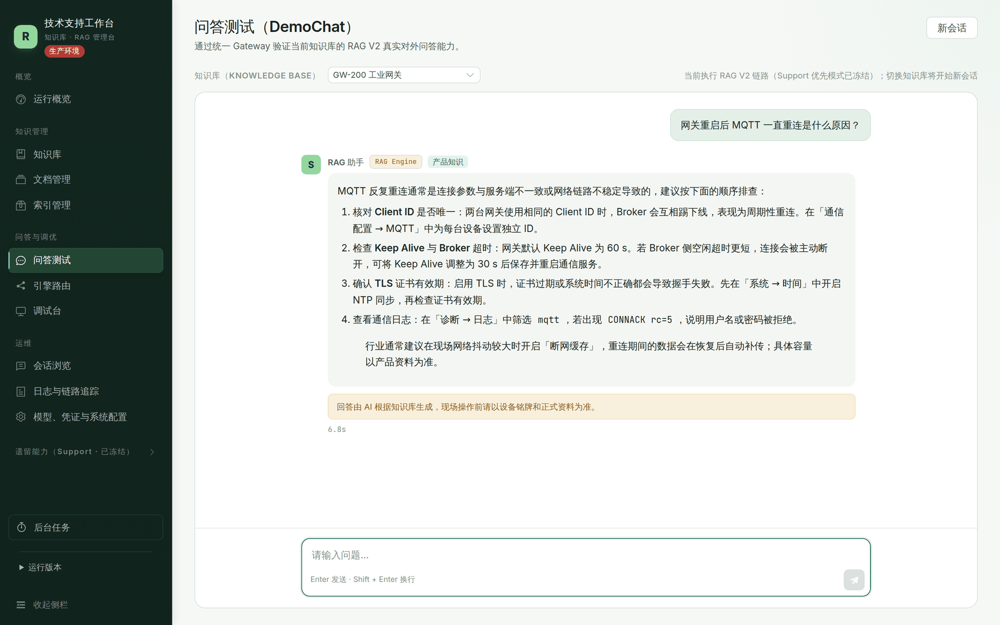
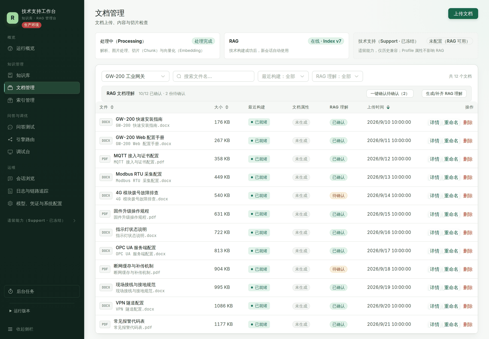
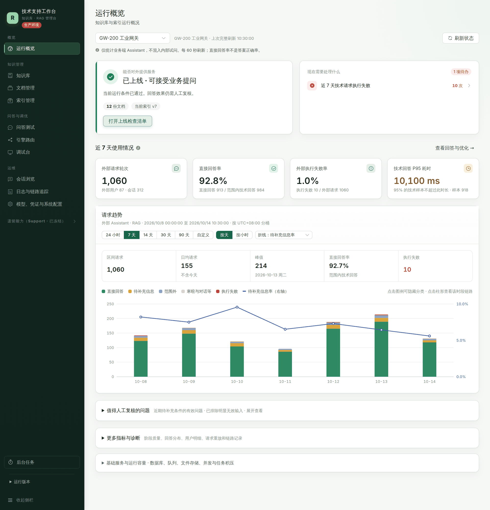
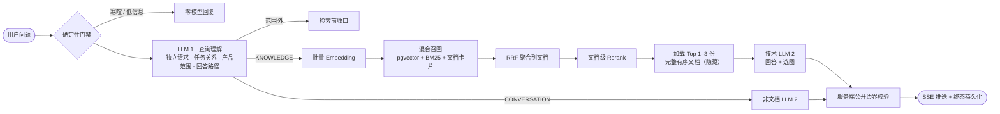
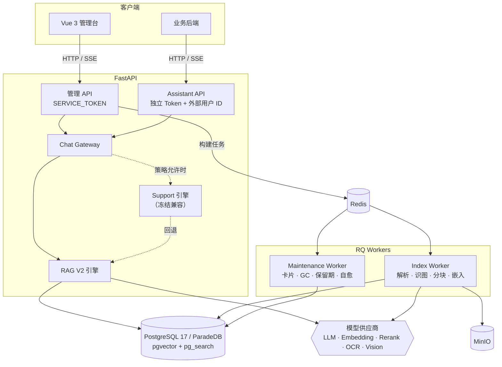

<div align="center">

# ShipRAG

**面向工程现场的企业知识库与技术支持问答平台**

让 LLM 读完整份手册再回答，而不是对着几段碎片猜答案。


[](LICENSE)

[核心设计](#核心设计隐藏全文双-llm) · [亮点](#亮点) · [架构](#系统架构) · [快速开始](#快速开始) · [质量体系](#质量体系) · [文档](#文档导航)

</div>

---

管理员在 Web 管理台上传 DOCX / PDF 技术文档，平台负责解析、识图、分块、向量化，并构建**版本化、可回滚**的索引。用户提问时，系统先理解问题，再检索到**文档级**，把排名最高的 1～3 份**完整文档**作为隐藏上下文交给模型，生成带配图的回答，最后通过 SSE 推送。

平台另外提供一套**独立凭据的 Assistant API**，业务后端可以把问答能力接入自己的产品，不需要暴露任何管理权限。

> 项目已部署到生产环境，有 40 余份架构决策记录（ADR）、49 个 Alembic 迁移、1,000 多个后端测试用例和 53 个真实模型黄金回归用例。

## 界面预览

<table>
  <tr>
    <td width="50%"></td>
    <td width="50%"></td>
  </tr>
  <tr>
    <td align="center">问答测试：按步骤给出排查方案，并标明行业通用知识</td>
    <td align="center">文档管理：DOCX / PDF 构建状态与文档理解卡片确认</td>
  </tr>
</table>

<p align="center"></p>
<p align="center">运行概览：上线状态、待办、近 7 天回答指标与请求趋势</p>

> 截图中的知识库、文档、问答和统计数字均为虚构的演示数据。

## 核心设计：隐藏全文双 LLM

传统 RAG 把 Top-K 个 Chunk 拼进 Prompt。对**操作手册、故障排查**这类文档来说，这种做法有个硬伤：步骤被切散，前提条件和警告留在另一个 Chunk 里，模型只能补全或者猜。

ShipRAG 的 RAG V2 换了思路：**检索负责找对文档，模型负责读完整文档。**



- **职责单一的两个 LLM**：LLM 1 只做“理解”。它还原省略指代的独立请求，判断是新任务、追问还是纠正，决定产品范围以及是否需要查文档。LLM 2 只做“回答”。范围由 LLM 1 唯一决定，冲突由服务端确定性归一，不会多出第三次模型调用。
- **不是每个问题都要检索**：确认、致谢、改写上一条回答这类轮次走 `CONVERSATION` 路径，跳过 Embedding、检索和 Rerank。拿不准时保守地走 `KNOWLEDGE`。
- **每轮重新检索**：不维护“焦点文档”状态机，换话题不会被上一轮的文档锁住。追问时，上一轮实际用到的文档会以零初始分作为软候选参与 Rerank，减少追问时的检索漂移。
- **全文只给模型看**：用户看到的是答案和服务器按白名单交付的配图。原文、候选列表、Prompt、文档总数和对象存储位置都不会出现在公开响应里。
- **降级不跳回旧链路**：Rerank 失败时保留 RRF 顺序，LLM 1 不可用时使用原问题，Embedding 失败时退到 BM25 和卡片通道。所有降级状态都写进 Trace，在 Dashboard 上统计降级率。

## 亮点

### 回答可信：证据分层与红线

产品用户都是专业工程人员，“查不到就不说”并不实用。平台把依据分成三层（[ADR-0029](docs/ai/decisions.md)）：

| 依据层级 | 表述方式 |
| --- | --- |
| 检索到的产品文档 | 可作为本产品信息直接陈述 |
| 管理员维护的产品档案 | 可作为本产品信息直接陈述 |
| 行业通用知识 | 只能用“行业通常 / 典型”的措辞，并说明资料未提供 |

**硬红线**：电压电流额定值、接线端子定义、端口、IP、固件版本这类说错会损坏设备的参数，没有文档依据就不给具体值；不得编造文档、手册或章节名。

### 文档理解卡片与人工确认门禁

每份文档都会生成一张结构化的**理解卡片**（任务、适用前提、触发条件等），参与召回和文档级 Rerank。

- 卡片随索引版本冻结，内容未变的文档**跨版本复用**，只为新增或变更的文档调用 LLM。
- 编辑和审核使用乐观锁（`expected_revision`）。**活动索引里的每份文档都要经过人工确认**，知识库才能对外上线。

### 索引版本化与模型身份指纹

- 每次构建产生一个独立的候选索引，管理员激活后才生效。**会话冻结自己使用的索引版本**，切换版本不会改变进行中会话的语义。
- 每次构建记录实际使用的 Embedding / OCR / Vision 模型身份（Provider、模型、端点、维度，不含密钥）。文档的源哈希、解析版本和模型指纹**全部匹配**时才复用旧结果。
- Embedding 身份漂移时直接返回 `INDEX_EMBEDDING_MISMATCH`，**不会静默地拿新向量空间去查旧索引**。

### 失败关闭，拒绝“假装在运行”

- 五类模型（LLM / Embedding / Rerank / OCR / Vision）是“真实 / 模拟 / 不可用”，由**同一张判定表**决定，管理台只读取它的结论。
- staging / production 环境**禁止任何形式的 fake 模型**。缺少凭据时启动失败或明确报错，不会退化成模拟输出（[ADR-0034](docs/ai/decisions.md)）。
- 运行版本来自镜像内不可变的构建标记，而不是服务器上当前的 Git 目录（[ADR-0031](docs/ai/decisions.md)）。

### 可集成的 Assistant API

为业务后端设计的窄化契约，和管理 API **在凭据层面完全隔离**：

- 独立的 `ASSISTANT_SERVICE_TOKEN`，每个请求都必须携带 `X-External-User-ID`，会话按外部用户隔离。
- `Idempotency-Key` 保证重试安全。首次流式完成、历史消息和幂等重放**返回同一份公开终态**。
- 公开 SSE 事件：`accepted → progress → context → delta → complete / error`，上游空闲时每 15 秒发送一次心跳。
- 知识库的对外上线状态独立于后台维护状态，新建的知识库默认不对外开放。

### 运行韧性

- **轮次准入闸门**：并发超过上限时快速返回 `503 SERVICE_BUSY`，被拒绝的请求不消耗幂等键。
- **自动自愈**：长时间停在 `RUNNING` 的轮次会被定期统一收口为失败，被锁住的会话自动恢复。
- **Worker 职责拆分**：索引 Worker 和维护 Worker 分开运行，长时间的构建任务不会阻塞清理和维护。
- **文档级熔断与协作取消**：同一文档同一错误失败 2 次后跳过，其余文档继续构建。构建可以在文档边界取消，重试由管理员决定。
- **生产容器加固**：基础设施镜像锁定版本（ParadeDB 固定到 digest），运行时容器使用只读根文件系统加 `/tmp` tmpfs。

### 能读“脏文档”的摄取管线

- **DOCX**：兼容旧式 VML 图片，保留重复图片的实际出现次数。遇到无法可靠还原顺序的浮动文字版式时**中止构建**，不拼出错乱的步骤。
- **PDF**：按（页码、纵坐标、横坐标）还原阅读顺序，图文自然交错；通过字号聚类推断 h1–h3 标题；剔除跨页重复的页眉、页脚、页码和重复图片。
- **图片**：接入 OCR 和视觉模型。单张图片解码失败时跳过并告警，不拖垮整次构建。

### 可观测、可复核

- 每轮问答写入 Trace：运行快照、各阶段状态、耗时、降级原因和模型用量。**只记录哈希、ID 和计数，不复制文档全文。**
- Dashboard 按引擎、来源、知识库和时间窗口统计直接回答率、待补充信息率、范围外率和各阶段降级率。
- 回答复核、会话浏览、全局任务中心和隔离复测，都基于保存的快照进行，不会触发模型重新生成。

### 多模型供应商，网页配置下一轮生效

- 支持 SiliconFlow、智谱和阿里云百炼 DashScope。DashScope 覆盖全部五类模型。
- 模型密钥在数据库中**加密存储**，支持轮换。LLM 和 Rerank 配置在**下一轮问答**生效，不需要重启或重建索引。
- LLM 2 的 Prompt 把静态规则放在前、逐请求数据放在后，可以命中供应商的隐式前缀缓存。

### 以证据驱动的 Prompt 工程

- Prompt 文本是**模块常量，作为单一来源**。管理台展示的提示词清单由真实常量生成，不会和线上实际使用的版本漂移。
- 每次改动 Prompt 都做**预设关卡的受控对照实验**，保存全部原始结果；用 sha256 逐字节核对重构前后的提示词。
- 原则：不为单题失败添加特判，**不以规则数量或机械通过率判定改进有效**（[ADR-0035](docs/ai/decisions.md)）。

### AI 原生的工程协作

仓库自带一套给 AI 和人共同使用的**认知文档体系**：[AGENTS.md](AGENTS.md) 是入口，再按问题路由到 [`docs/ai/`](docs/ai/) 中的架构、前后端、数据库、环境、当前状态、已知问题和 [42 份 ADR](docs/ai/decisions.md)。每项任务都按“读取 → 实施 → 验证 → 更新认知”闭环完成，项目的长期决策和取舍有据可查。

## 系统架构



| 层 | 技术 |
| --- | --- |
| 前端 | Vue 3.5、TypeScript、Vite 7、Element Plus（按需注册、视图异步分包）、Vitest |
| 后端 | Python 3.11–3.14、FastAPI、SQLAlchemy async + asyncpg、Pydantic Settings、structlog |
| 任务 | Redis + RQ，索引队列和维护队列分别由独立的 Worker 消费 |
| 数据 | PostgreSQL 17 / ParadeDB（`vector` 1024 维 + `pg_search` BM25）、Alembic、MinIO |
| 摄取 | mammoth + OOXML、pdfplumber、Pillow |
| 部署 | Docker Compose、Nginx 同域代理、只读根文件系统 |

## 管理台

| 模块 | 功能 |
| --- | --- |
| 概览 Dashboard | 近 7 天的回答结果分布、回答依据分布、V2 阶段降级率、趋势下钻、待复核列表 |
| 知识库与文档 | 上传、显示名维护、服务端分页 / 搜索 / 排序，按构建状态和卡片状态筛选 |
| 索引 | 候选构建、激活、重试、协作取消、按库回收、“待重建”提示 |
| 文档理解卡片 | 生成、编辑、审核、一键确认，Assistant 上线清单 |
| 模型与运行策略 | 五类模型配置与连通性探测，实际运行判定（真实 / 模拟 / 不可用）横幅 |
| 问答测试与会话 | 调试台、按渠道浏览会话、回答复核与隔离复测 |
| 日志与链路 | Trace 详情、失败列表、请求错误日志 |
| 任务中心 | 全局后台任务的进度与终态，统一串行轮询 |

## 快速开始

**前置条件**：Python `>=3.11,<3.15`、Node.js `>=20.19.0`、Docker Compose。

```bash
# 1. 创建 .venv，安装前后端依赖；没有 .env 时从 .env.example 生成
bash scripts/bootstrap.sh

# 2. 启动基础设施，执行迁移，启动 API、两个 Worker 和前端开发服务器
bash scripts/dev-up.sh
```

| 服务 | 地址 |
| --- | --- |
| 管理台 | http://127.0.0.1:5173 |
| API | http://127.0.0.1:18000 |

启动前请先审阅 `.env.example`，在本地 `.env` 或部署 Secret 中填写模型凭据和 Token。**不要提交 `.env`、Token、API Key 或数据库密码。** 开发环境的详细说明见 [开发启动指南](docs/dev-startup.md)；生产部署使用 `compose.production.yaml`，见 [环境、启动与验证](docs/ai/environment.md)。

## 接口边界

| | 管理 API | Assistant API |
| --- | --- | --- |
| 路径 | `/api/v1/*` | `/api/v1/assistant/*` |
| 凭据 | `SERVICE_TOKEN` | `ASSISTANT_SERVICE_TOKEN` + `X-External-User-ID` |
| 面向 | 管理台、运维 | 业务后端集成 |
| SSE 事件 | `status`、`trace`、`message`、`fallback`、`done` / `error` | `accepted`、`progress`、`context`、`delta`、`complete` / `error` + 心跳 |

两套接口的字段和事件名不能混用。完整契约见 [Assistant API 对接文档](docs/integration/assistant-api-integration-guide.md)，实施步骤见 [业务后台对接指南](docs/integration/assistant-api-business-backend-guide.md)。

## 质量体系

```bash
# 后端 Ruff / Mypy / Pytest + 冒烟（覆盖率 ≥ 80%），前端 ESLint / vue-tsc / Vitest / 构建
bash scripts/check.sh

# RAG 真实链路黄金集回归（需要已启动的服务、目标知识库和可用的模型配置）
.venv/bin/python rag-acceptance/run_golden.py

# 生产门禁：配置校验、容器 smoke 和发布验收
bash scripts/check-m7.sh
```

- **后端**：1,000 多个 Pytest 用例，包括 PostgreSQL 集成测试；有 Ruff 和 Mypy 静态检查。
- **前端**：44 个 Vitest 测试文件，覆盖 API 适配层、状态、视图和交互；有 ESLint（零警告）和 vue-tsc 检查。
- **[黄金集](rag-acceptance/README.md)**：53 个用例 / 63 轮真实请求，同时校验文档命中和回答正文。
- **[受控实验记录](rag-acceptance/)**：每次 Prompt 或策略调整都留有预设关卡、原始样本和结论，包括没有通过、最终未采纳的实验。

命令能否运行、结果如何，取决于当前环境，本文不能代替实际运行结果。

## 项目结构

```text
.
├── backend/
│   ├── app/
│   │   ├── api/            # HTTP / SSE 路由，管理与 Assistant 两条认证边界
│   │   ├── gateway/        # 运行策略、引擎调度、就绪门禁
│   │   ├── rag/v2/         # 查询理解 → 文档检索 → 全文上下文 → 回答生成 → 校验
│   │   ├── ingestion/      # DOCX / PDF 解析、识图、分块、嵌入、索引构建
│   │   ├── assistant/      # 对外门面、公开响应过滤、幂等与恢复
│   │   ├── tasks/          # RQ 任务、GC、保留期清理、自愈
│   │   └── observability/  # Trace 与错误日志
│   ├── alembic/versions/   # 数据库架构的权威迁移历史
│   └── tests/
├── frontend/src/           # Vue 3 管理台
├── rag-acceptance/         # 黄金集与受控实验
├── docs/
│   ├── ai/                 # 认知文档与 ADR
│   ├── integration/        # Assistant API 对接文档
│   └── technical/          # 技术方案与执行计划
├── scripts/                # 引导、启动、校验、构建、部署
├── compose.yaml            # 本地基础设施
└── compose.production.yaml # 生产编排
```

## 文档导航

| 主题 | 文档 |
| --- | --- |
| Agent 工作入口、文档路由和维护规则 | [AGENTS.md](AGENTS.md) |
| 系统架构与数据流 | [architecture.md](docs/ai/architecture.md) |
| 前端、后端、数据库 | [frontend.md](docs/ai/frontend.md)、[backend.md](docs/ai/backend.md)、[database.md](docs/ai/database.md) |
| 环境、命令和生产部署 | [environment.md](docs/ai/environment.md) |
| 当前状态、已知问题、技术决策 | [current-state.md](docs/ai/current-state.md)、[known-issues.md](docs/ai/known-issues.md)、[decisions.md](docs/ai/decisions.md) |
| 对外 Assistant API 完整契约 | [assistant-api-integration-guide.md](docs/integration/assistant-api-integration-guide.md) |
| 业务后台对接实施指南 | [assistant-api-business-backend-guide.md](docs/integration/assistant-api-business-backend-guide.md) |
| RAG 隐藏全文双 LLM V2 执行计划（当前唯一 RAG 路径） | [rag-full-document-generation-v2-execution-plan.md](docs/technical/rag-full-document-generation-v2-execution-plan.md) |
| 已被 V2 取代的历史方案 | [语义编排](docs/technical/rag-semantic-orchestration-execution-plan.md)、[小体量技术助手](docs/technical/rag-technical-assistant-optimization-plan.md) |
| 运维与 RAG 回归 | [ops-runbook.md](docs/ops-runbook.md)、[rag-acceptance/README.md](rag-acceptance/README.md) |

## 协作约定

处理项目任务前，先阅读 [AGENTS.md](AGENTS.md)，再按任务读取相关的 `docs/ai/` 文档；一切以当前源码、配置、迁移和实际验证结果为准。完成涉及架构、环境、数据模型、当前状态或已知问题的改动后，同步更新对应的认知文档。

## 许可证

本项目以 [MIT License](LICENSE) 开源。
